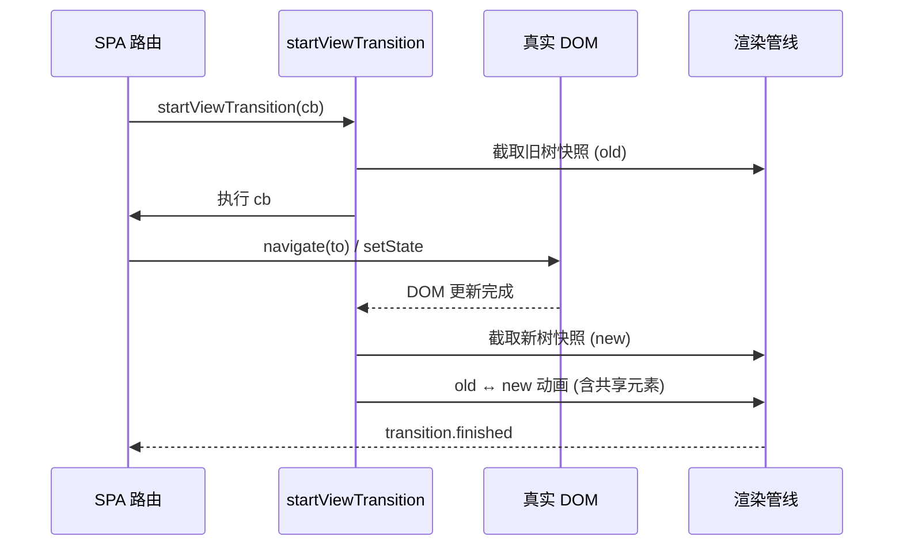

<!-- post-id: 188694fce84a4318 -->

# SPA 也能像原生 App：View Transitions API 从原理到可上线实战

> 发布日期：2026-10-12  
> 标签：前端 / CSS / View Transitions / SPA / 用户体验 / 性能


## 一、开篇：那个让你 SPA「掉价」的瞬间

你一定遇到过这个画面：在一个精心打磨过的列表页，点开一个卡片进详情——白屏闪一下，详情页「啪」地砸上来。一整套设计系统、动效、骨架屏都到位了，**就这一下，App 感全没了**。

更扎心的是对比。同一个需求，原生 App 的实现是：手指按下列表项的瞬间，封面图就开始从原位「长」出来，文字跟着展开，整个过程手指还没抬起来就启动了——用户感知不到「切换」，只感知到「展开」。而你的 SPA 呢？点击 → 卸载列表组件 → 请求详情数据 → 挂载详情组件 → 渲染 → 用户终于看到。中间每一步都是肉眼可见的「等待」。

用户不会说「你的路由切换缺少过渡动画」。他们只会觉得「这网页有点糙」。

原生 App 这件事做得很自然：iOS 的「共享元素转场」会把列表里的封面图「拎」起来，飞到详情页顶部，文字顺势展开。整个过程连贯、有空间感、暗示了「我从哪来」。而传统 SPA 路由切换，本质上是：

> 卸载旧组件 → 挂载新组件 → 浏览器重新绘制。

中间没有「过渡」这一层。我们用各种补丁去填：路由级 `CSSTransition`、`framer-motion` 的 `AnimatePresence`、手写 FLIP（First-Last-Invert-Play）。能用，但都很贵——要么自己维护一套位置追踪，要么把动画逻辑塞进框架生命周期，要么在 SSR / hydration 边缘反复踩坑。

直到 Chrome 111 落地 **View Transitions API**，这件事终于有了「浏览器原生」的解法。一句话概括它的价值：

> 让 SPA 在路由切换时，拥有原生 App 那种「共享元素飞过去」的转场，而你的代码几乎不用碰动画细节。

这篇文章不是 API 文档搬运。我想跟你聊的是：**它到底怎么工作、在真实 SPA 里怎么落地、什么时候该用、什么时候别硬上**。代码都能抄，坑都标好了。

先放一张「方案对比」表，帮你快速判断要不要从现有方案迁过来：

| 方案 | 实现成本 | 性能 | 维护成本 | 适用场景 |
|------|---------|------|---------|---------|
| 手写 FLIP | 高（自己算位置、自己 rAF） | 中（主线程跑动画） | 高（位置追踪易错） | 需要完全控制动画曲线 |
| framer-motion `AnimatePresence` | 中（学 API） | 中（依赖 React 重渲染） | 中（耦合组件树） | React 项目、组件级动画 |
| react-transition-group + CSS | 低 | 中 | 中（CSS 状态机繁琐） | 简单进出动画 |
| **View Transitions API** | **低（一行 API）** | **高（合成器线程）** | **低（浏览器托管）** | **路由级、共享元素、主题切换** |

结论很直白：**只要浏览器支持，路由级转场就该首选 View Transitions**。它把「动画逻辑」从你的组件树里剥离出来，交给浏览器，你只管「什么时候改 DOM」。这种关注点分离带来的维护收益，比性能优势更值钱。

***

## 二、原理一层：浏览器替你干了什么

### 2.1 一行 API，背后是一套管线

核心就一个方法：

```typescript
document.startViewTransition((transition) => {
  // 在这里同步更新 DOM
});
```

你只负责「告诉浏览器什么时候改 DOM」，剩下的截图、动画、合成，浏览器全包了。具体管线长这样：


拆开看五步：

1. **调用**：你调 `startViewTransition(cb)`，浏览器先把当前页面「冻结」成一帧快照。
2. **截取旧树**：把当前 DOM 渲染成一张图，挂到 `::view-transition-old(name)` 上。
3. **cb 更新 DOM**：你传的回调执行——切路由、`setState`、写数据，**真正的 DOM 变更发生在这里**。
4. **截取新树**：cb 返回的 Promise resolve 后，浏览器对新 DOM 再截一张图，挂到 `::view-transition-new(name)`。
5. **动画过渡**：默认是 old 和 new 两层交叉淡入淡出；如果你给某些元素标了 `view-transition-name`，它们会被「拎出来」单独做位移 / 缩放动画。

关键认知：**cb 是「同步 DOM 更新」的边界**。cb 里不要去发请求、不要做长任务——浏览器在等它的 Promise resolve 才能截新树。cb 越干脆，转场越顺。

这里有个容易误解的点：cb 可以返回 Promise，浏览器会等它 resolve 再截新树。听起来好像可以在 cb 里发请求？**技术上可以，但强烈不建议**。因为这意味着用户点进去后，页面会「卡在旧树快照上」干等数据——旧树是一张图，没有任何交互响应，用户点击没反应、滚动没反应，体感是「网页死了」。正确做法永远是：**先在 cb 外把数据拿好，再进 cb 同步切 DOM**。cb 内的 Promise 主要是为了配合框架的异步渲染（比如 React 18 的 `useTransition`、Vue 的 `nextTick`），而不是给你发请求用的。

另一个值得理解的细节是「截图」的本质。浏览器截的并不是真的位图，而是把对应 DOM 子树提升到独立的合成层（compositing layer），相当于给每个 `::view-transition-group` 单独开一个 GPU 图层做动画。这意味着：

- 转场动画走的是合成器线程（compositor），不阻塞主线程，所以即使你 JS 在跑别的，动画也能顺。
- 共享元素的位移 / 缩放是「图层变换」，不是重新 layout，性能远好于你自己用 `transform` 模拟的 FLIP。
- 但代价是内存：每个 name 一张图层，列表场景下几十个 name 同时存在会吃显存。所以**别给整个列表所有项都打 name**，只给「当前要飞的那一项」打。

### 2.2 伪元素树：动画的「舞台」

转场期间，浏览器会在你的真实 DOM 之上盖一层伪元素树：

```text
::view-transition                 /* 根，覆盖整个视口 */
  └─ ::view-transition-group(name)   /* 每个 name 一个，负责位移/缩放 */
       ├─ ::view-transition-old(name)  /* 旧树快照 */
       └─ ::view-transition-new(name)  /* 新树快照 */
```

默认动画就是 old 透明度 1→0、new 透明度 0→1，交叉淡入淡出。你想自定义，直接写 CSS 覆盖这两个伪元素的 `animation` 即可——后面会演示。

### 2.3 view-transition-name：共享元素的「身份证」

这是整个 API 最值钱的一个属性。给两个元素标上**相同的 `view-transition-name`**，浏览器就会认为它们是「同一个东西」，在旧树和新树之间单独做位移 / 缩放动画——这就是原生 App 那种「封面图飞过去」的效果。


三条铁律（踩过都疼）：

1. **同一时刻，同一个 name 全局只能有一个元素**。列表里 20 个卡片都叫 `cover`？直接报错 `view-transition-name` 冲突，转场中断。
2. **列表项的 name 必须随数据动态化**，比如 `cover-{item.id}`。
3. **虚拟滚动场景下，元素卸载前要清空 name**，否则会留下「幽灵 name」触发空转场。

理解了这三点，你已经比一半上手的人少踩坑了。

补充一个常被忽略的机制：**name 是「瞬时匹配」的，不是「持久绑定」的**。浏览器只在 `startViewTransition` 那一刻，去旧树里找带某个 name 的元素、去新树里找带同一个 name 的元素，然后给它们配对做动画。配对完成后，name 本身的存在与否就不再重要了。这意味着：

- 你可以在 cb 里把旧元素的 name 清掉、给新元素加上 name，只要「截旧树时旧元素有 name、截新树时新元素有 name」即可。
- 反过来，如果你给一个元素打了 name，但旧树和新树里都存在同 name 的元素且位置没变，浏览器会做一个「原地淡入淡出」——这通常不是你想要的。共享元素的价值在于「位置变了」，位置没变就别打 name，省得白做一层动画。

实际项目里，我习惯把 name 的赋值收敛到一个地方：**进入转场前给目标元素打 name，转场结束的 `finished` 回调里清掉**。这样 name 的生命周期清晰，不会在页面常态下残留，也不会因为多个元素短暂同时拥有 name 而冲突。

### 2.4 用 mermaid 串一下时序



一句话总结：**你管 DOM 什么时候变，浏览器管它怎么变过去**。

### 2.5 转场的生命周期：四个 Promise

`startViewTransition` 返回一个 transition 对象，上面挂了四个关键的 Promise，理解它们能让你在更复杂的场景里精确控制：

```typescript
const vt = document.startViewTransition(() => updateDOM());

vt.ready           // 伪元素树已挂载，动画即将开始 → 可在这里改动画
vt.updateCallbackDone  // cb 已执行完，DOM 已更新（但动画还没开始）
vt.finished        // 动画正常结束，伪元素树已清理
vt.skipped         // 动画被跳过（比如 skipTransition() 或新转场打断）
```

实战中最常用的是 `ready`：默认动画即将开始前，你可以在这里用 `Element.animate()` 覆盖某个伪元素的动画，比如前面暗色模式的圆形扩散就是挂在 `ready` 上的。`finished` 用于清理 name、解锁重入。`updateCallbackDone` 用于「cb 失败了要不要回滚」——如果 cb 抛错，你可以选择不进入动画，直接把 DOM 还原。

一个带错误处理的封装：

```typescript
async function safeTransition(update: () => void) {
  if (!supportsVT || reduceMotion) return update();

  let vt;
  try {
    vt = document.startViewTransition(update);
    await vt.updateCallbackDone; // 等 DOM 更新成功
  } catch {
    // cb 抛错，DOM 可能处于中间态，这里做回滚或上报
    return;
  }
  await vt.finished; // 等动画结束
}
```

这套生命周期是 View Transitions 区别于「自己写动画」的关键——它给了你在「DOM 已变 / 动画未始」「动画结束 / 异常」这些节点上插钩子的能力，而不用自己拿 `requestAnimationFrame` 去赌时机。

***

## 三、最小可跑 Demo：列表 → 详情共享封面

不啰嗦，先上一段纯 HTML/CSS/JS，能直接粘到 `vite` 项目里跑。两个视图：列表点详情，封面图共享飞过去。

```html
<!-- index.html -->
<div id="app">
  <section id="list-view">
    <div class="card" data-id="1">
      
      <h3>第一篇</h3>
    </div>
    <div class="card" data-id="2">
      
      <h3>第二篇</h3>
    </div>
  </section>

  <section id="detail-view" hidden>
    
    <h2>详情标题</h2>
    <p>详情正文…</p>
    <button id="back">返回</button>
  </section>
</div>
```

```css
/* 关键：给封面图一个动态 name */
.cover {
  view-transition-name: var(--vt-name, none);
}

::view-transition-old(root),
::view-transition-new(root) {
  animation-duration: 0.28s;
  animation-timing-function: cubic-bezier(0.22, 1, 0.36, 1);
}
```

```typescript
// router.ts —— 伪 SPA 路由
function showDetail(id: string, coverSrc: string) {
  const cover = document.querySelector('#detail-view .cover') as HTMLImageElement;
  cover.src = coverSrc;
  document.documentElement.style.setProperty('--vt-name', `cover-${id}`);

  const update = () => {
    document.querySelector('#list-view')!.setAttribute('hidden', '');
    document.querySelector('#detail-view')!.removeAttribute('hidden');
  };

  const supportsVT =
    typeof document.startViewTransition === 'function';
  if (supportsVT) {
    document.startViewTransition(() => update());
  } else {
    update();
  }
}

function back() {
  const update = () => {
    document.querySelector('#detail-view')!.setAttribute('hidden', '');
    document.querySelector('#list-view')!.removeAttribute('hidden');
  };
  document.documentElement.style.setProperty('--vt-name', 'none');

  const supportsVT =
    typeof document.startViewTransition === 'function';
  if (supportsVT) {
    document.startViewTransition(() => update());
  } else {
    update();
  }
}

document.querySelectorAll('.card').forEach((card) => {
  card.addEventListener('click', () => {
    const el = card as HTMLElement;
    const id = el.dataset.id!;
    const src = (el.querySelector('.cover') as HTMLImageElement).src;
    showDetail(id, src);
  });
});
document.querySelector('#back')!.addEventListener('click', back);
```

跑起来，点列表项：封面图会从列表里「飞」到详情页顶部，其余部分交叉淡入。这就是 30 行代码换来的 App 感。

注意这里用 CSS 变量 `--vt-name` 来传 name，而不是直接给每个 `.cover` 写死 `view-transition-name`——**因为列表里多个 `.cover` 同时存在，写死同一个 name 就冲突了**。用变量 + 切换时赋值，是处理「列表场景」最干净的方式。

这个 demo 虽然小，但已经体现了 View Transitions 最核心的三个工程决策：

1. **name 的动态化**：用 CSS 变量在「切页瞬间」赋值，避免列表多元素静态冲突。
2. **降级路径**：`supportsVT` 判断后，不支持就老老实实 `update()`，行为退回普通 SPA。
3. **name 的清理**：返回时把 `--vt-name` 重置为 `none`，为下次进入留干净状态。

把这三点记住，后面接框架时你会发现，所有封装都是在围绕这三件事打转。

***

## 四、React / Vue SPA 落地：包一层就够

真实项目里你不会手写路由。下面给 React Router 和 Vue Router 各一个最小封装，思路一致：**拦截路由变更，包一层 `startViewTransition`**。

### 4.1 React Router


```typescript
// ViewTransitionRouter.tsx
import { useNavigate } from 'react-router-dom';
import { useCallback, useRef } from 'react';

const supportsVT =
  typeof document !== 'undefined' &&
  typeof document.startViewTransition === 'function';

export function useViewTransitionNavigate() {
  const navigate = useNavigate();
  const navigating = useRef(false);

  return useCallback(
    (to: string) => {
      if (!supportsVT || navigating.current) {
        navigate(to);
        return;
      }
      navigating.current = true;
      const vt = document.startViewTransition(() => {
        navigate(to);
      });
      vt.finished.finally(() => {
        navigating.current = false;
      });
    },
    [navigate]
  );
}

// 组件里
function ArticleCard({ item }: { item: { id: string; cover: string } }) {
  const go = useViewTransitionNavigate();
  return (
    <div
      onClick={() => go(`/article/${item.id}`)}
      style={{ viewTransitionName: `cover-${item.id}` }}
    >
      
    </div>
  );
}
```

几个要点：

- **`navigating.current` 防重入**：用户连点会触发多个 `startViewTransition`，第二个会等第一个结束才开始，体验是「卡一下再切」。加个 ref 拦掉。
- **`vt.finished` 兜底清理**：动画结束（或被中断）后再放开锁，避免状态卡死。
- **name 写在 inline style 里**：React 里动态 `view-transition-name` 用 style 最直接，别用 className 拼，容易和 CSS 里的静态 name 撞车。

补充一句：React 19 已经内置了 `useViewTransition` Hook，内部把上面这套防重入、降级、并发处理都封装好了。如果你的项目跑在 React 19 上，**优先用官方的，别自己造轮子**。本文给封装是为了讲清楚原理，以及给还在 React 17/18 或 Vue 项目的人一个可直接抄的实现。判断标准很简单——能用官方的就别自己维护，自己维护的每一行都是未来的技术债。

### 4.2 Vue Router

Vue 的封装更短，因为 `router.push` 本身返回 Promise：

```typescript
// router/index.ts
import { createRouter } from 'vue-router';

const supportsVT =
  typeof document !== 'undefined' &&
  typeof document.startViewTransition === 'function';

const router = createRouter({ /* routes */ });

let navigating = false;
const originalPush = router.push.bind(router);

router.push = (to) => {
  if (!supportsVT || navigating) return originalPush(to);
  navigating = true;
  const vt = document.startViewTransition(() => originalPush(to));
  return vt.finished.finally(() => {
    navigating = false;
  });
};
```

组件里给封面图打 name：

```vue
<template>
  <div
    class="card"
    :style="{ viewTransitionName: `cover-${item.id}` }"
    @click="$router.push(`/article/${item.id}`)"
  >
    
  </div>
</template>
```

Vue 这边有个比 React 更顺手的地方：`router.push` 返回的 Promise 在 DOM 更新完成后才 resolve，配合 `await nextTick()` 能保证新树稳定。所以 Vue 的封装几乎不用担心「截到一半的渲染」问题，这也是为什么 Vue 项目的接入往往比 React 顺。如果你用的是 Nuxt 3，它甚至在实验性特性里直接提供了 `nuxt-view-transitions`，连封装都省了——开个配置就行。能用框架自带的能力，就别自己维护。

### 4.3 三个高频陷阱

**陷阱一：异步数据没 ready 就进 cb。** 你点进详情，cb 里 `navigate`，但详情页数据还在请求——新树截到的是骨架屏，封面图根本没渲染，共享元素动画飞到一半就「断」了。解法：**先 await 数据，再进 `startViewTransition`**。cb 里只做同步 DOM 更新。

```typescript
// 错：新树截到骨架屏
document.startViewTransition(() => navigate(to));

// 对：数据 ready 后再转场
await fetchArticle(id);
document.startViewTransition(() => navigate(to));
```

**陷阱二：列表虚拟滚动残留 name。** react-window / vue-virtual-scroller 把滚出视口的项卸载了，但你给它写了 `view-transition-name: cover-{id}`——元素没了 name 也没了，但**如果转场进行中元素被卸载**，共享元素会突然消失。解法：转场期间锁住滚动，或给虚拟列表容器加 `contain: layout`。

**陷阱三：同页多卡片 name 重复。** 列表里每项 `cover-{id}` 是唯一的，但如果详情页同时展示「相关推荐」列表，里面又有一项 id 和当前页 cover name 撞了——boom。解法：**命名空间隔离**，比如列表用 `list-cover-{id}`、详情用 `detail-cover-{id}`，永远别让两个区域的 name 池重叠。

**陷阱四：和框架的并发模型打架。** React 18 的并发渲染（`useTransition`、Suspense）会把更新切成多帧，cb 里调 `navigate` 后，DOM 变更可能不是同步完成的——浏览器截新树时，截到的可能是「渲染了一半」的状态。解法有两个：要么在 cb 里用 `flushSync` 强制同步刷新（简单粗暴，但失去并发优势）；要么用 React 19 的 `useViewTransition` Hook（官方已封装好，内部处理了并发）。Vue 这边相对省心，`nextTick` 后 DOM 就是稳定的，cb 里 `await nextTick()` 即可。

**陷阱五：SSR / hydration 边界。** 服务端没有 `document`，如果你在模块顶层就调用 `document.startViewTransition`，SSR 会直接报错。封装时务必把 `typeof document` 判断放在调用处，而不是模块加载时。另外，hydration 完成前不要启用转场——未 hydrate 的 DOM 是「不可交互」的，强行转场会闪。一个稳妥的做法是监听 `hydration` 完成事件后再注册路由钩子。

***

## 五、进阶好玩点：把 API 玩出花

### 5.1 暗色模式：根级圆形扩散转场

切深色 / 浅色主题，传统做法是切个 class，颜色「啪」地变。用 View Transition 可以做一个**整页圆形扩散**的转场，体验拉满。

```typescript
function toggleTheme(e: MouseEvent) {
  const x = e.clientX;
  const y = e.clientY;
  const endRadius = Math.hypot(
    Math.max(x, innerWidth - x),
    Math.max(y, innerHeight - y)
  );

  const supportsVT =
    typeof document.startViewTransition === 'function';
  if (!supportsVT) {
    document.documentElement.classList.toggle('dark');
    return;
  }

  const vt = document.startViewTransition(() => {
    document.documentElement.classList.toggle('dark');
  });

  vt.ready.then(() => {
    document.documentElement.animate(
      {
        clipPath: [
          `circle(0px at ${x}px ${y}px)`,
          `circle(${endRadius}px at ${x}px ${y}px)`,
        ],
      },
      {
        duration: 400,
        easing: 'cubic-bezier(0.22, 1, 0.36, 1)',
        pseudoElement: '::view-transition-new(root)',
      }
    );
  });
}
```

这里有个反直觉的点：**默认 old 在 new 上面**（淡出旧树露出新树）。圆形扩散这种「新树从点击点铺开」的效果，要保证 new 在上面，得加一句：

```css
::view-transition-old(root) {
  animation: none;
  z-index: -1;
}
::view-transition-new(root) {
  animation: none;
  mix-blend-mode: normal;
}
```

把 old 的动画关掉并压到下面，让 new 的 `clipPath` 动画独占舞台。这个细节官方文档没强调，但你不加，效果就是「旧树盖在新树上扩散」——颜色对不上。

顺带说一个这个效果的进阶玩法：**从「点击点」扩散，而不是固定从中心**。上面代码里 `e.clientX / e.clientY` 已经是点击坐标，但如果是「点开关按钮切主题」，你希望从按钮位置扩散；如果是「快捷键切主题」，没有点击点，就退回中心。封装一下：

```typescript
function getOriginPoint(e?: MouseEvent): { x: number; y: number } {
  if (e) return { x: e.clientX, y: e.clientY };
  // 没有鼠标事件，从右上角开关位置扩散
  const btn = document.querySelector('[data-theme-toggle]');
  if (btn) {
    const r = btn.getBoundingClientRect();
    return { x: r.right, y: r.top };
  }
  return { x: innerWidth / 2, y: innerHeight / 2 };
}
```

这种「从交互发生的位置扩散」的设计语言，是原生 App 普遍在用的——iOS 控制中心、Material You 的主题切换都是这个套路。它给用户一个隐性的因果暗示：「我点了这里，变化从这里开始」，比无方向的淡入淡出高级一个档次。

### 5.2 自定义缓动与方向感动画

默认交叉淡入淡出是「无方向」的。你可以给路由切换加上方向感：前进是「新页从右滑入」，后退是「从左滑入」。

```css
/* 前进：新树从右进，旧树往左退 */
::view-transition-old(root) {
  animation: 0.3s cubic-bezier(0.22, 1, 0.36, 1) both fade-out-left;
}
::view-transition-new(root) {
  animation: 0.3s cubic-bezier(0.22, 1, 0.36, 1) both slide-in-right;
}

@keyframes fade-out-left {
  to { opacity: 0; transform: translateX(-3%); }
}
@keyframes slide-in-right {
  from { opacity: 0; transform: translateX(3%); }
}
```

后退时通过给 `documentElement` 加个 class 切换另一组动画即可。配合自己维护的一个方向标记（前进 / 后退）就能做到「左进右出 / 右进左出」的方向感，比单纯淡入淡出有空间感得多。

这里有个细节值得展开：**怎么判断前进还是后退**。SPA 里没有浏览器原生的 `navigation.type`，你得自己维护一个历史栈。最简单的做法是给每次 `navigate` 记录一个递增的序号，比较新旧序号判断方向：

```typescript
let navIndex = 0;
const history: string[] = [''];

function navigateWithDirection(to: string) {
  const isBack = history.includes(to) && history.indexOf(to) < navIndex;
  document.documentElement.classList.toggle('vt-back', isBack);
  document.documentElement.classList.toggle('vt-forward', !isBack);

  withViewTransition(() => {
    navIndex = isBack ? history.indexOf(to) : history.length;
    history.length = navIndex + 1;
    history.push(to);
    realNavigate(to);
  });
}
```

然后 CSS 里用 `.vt-back` 和 `.vt-forward` 分别配两组方向相反的 keyframes。这套机制不复杂，但能让你的 SPA 在「返回」时也有正确的方向暗示——用户会下意识地觉得「这个网页懂我往哪走」。

### 5.3 列表 ⇄ 详情：共享元素 + 数据预取

把 4.1 的封装和 5.1 的思路合起来，就是生产级列表 → 详情：

```typescript
async function openArticle(id: string) {
  // 1. 预取详情数据
  const article = await api.getArticle(id);
  // 2. 预加载详情页封面，避免新树截到空白
  await preloadImage(article.cover);
  // 3. 现在才进转场，新树截到的是完整详情
  document.startViewTransition(() => {
    navigate(`/article/${id}`);
  });
}

function preloadImage(src: string): Promise<void> {
  return new Promise((resolve) => {
    const img = new Image();
    img.onload = img.onerror = () => resolve();
    img.src = src;
  });
}
```

这套组合拳的效果：点列表项 → 封面图从列表位置平滑飞到详情页顶部，且详情页正文已经是完整内容，不是骨架屏。用户感知是「这个网页跟 App 一样」。代价是点进去有几十毫秒的预取等待——用 loading 指示器盖一下，体验上完全可接受。

这里再补一个实战技巧：**预取的「度」要把握好**。预取太多，用户只是随便划划列表，你就把所有详情数据都拉了，浪费流量和服务器压力；预取太少，点进去还是要等。一个折中方案是**悬停预取**（hover / pointerdown 时预取），既不浪费，又能在点击时大概率命中缓存：

```typescript
// 悬停时预取，点击时大概率命中
function usePrefetchOnHover() {
  const cache = useRef(new Map<string, Article>());

  const prefetch = useCallback((id: string) => {
    if (cache.current.has(id)) return cache.current.get(id)!;
    const p = api.getArticle(id).then((a) => {
      cache.current.set(id, a);
      return a;
    });
    cache.current.set(id, p);
    return p;
  }, []);

  return { prefetch, cache };
}

// 卡片：onMouseEnter 预取，onClick 用缓存
function ArticleCard({ item }: { item: { id: string; cover: string } }) {
  const { prefetch } = usePrefetchOnHover();
  const go = useViewTransitionNavigate();

  return (
    <div
      onMouseEnter={() => prefetch(item.id)}
      onClick={async () => {
        await prefetch(item.id); // 命中缓存，几乎 0 等待
        go(`/article/${item.id}`);
      }}
      style={{ viewTransitionName: `cover-${item.id}` }}
    >
      
    </div>
  );
}
```

移动端没有 hover，可以用 `onPointerDown` 替代——手指按下到抬起之间有约 100ms，足够预取大多数接口。这套「悬停 / 按下预取 + 点击转场」的组合，是内容站提升感知速度的标配。

***

## 六、可上线清单：六条硬指标


合并前逐条打勾，缺一条都不算「可上线」：

1. **特性检测兜底**：`typeof document.startViewTransition === 'function'` 才走转场，否则直接更新 DOM。不支持的浏览器必须能正常切页。
2. **尊重 reduced-motion**：`prefers-reduced-motion: reduce` 时跳过动画，仅做同步 DOM 更新。前庭敏感用户的硬需求。
3. **name 全局唯一**：同一时刻同 name 只能有一个元素；列表项用 `cover-{id}` 动态命名。冲突会直接报错并中断转场。
4. **异步数据先 ready**：先 `await` 数据再进 `startViewTransition` 的 cb；否则新树截到的是骨架屏。
5. **避开 CSS transition 冲突**：转场期间给容器加 `.vt-active`，暂停业务 `transition`，避免两层动画叠加抖动。
6. **虚拟滚动 name 清理**：列表项滚出视口卸载前清空 name，否则残留 name 触发「幽灵共享」。

降级路径也画一下，思路就是「能转场就转场，不能就老实更新」：


一个生产可用的封装长这样：

```typescript
// utils/viewTransition.ts
const supportsVT =
  typeof document !== 'undefined' &&
  typeof document.startViewTransition === 'function';

const reduceMotion =
  typeof matchMedia === 'function' &&
  matchMedia('(prefers-reduced-motion: reduce)').matches;

export function withViewTransition(update: () => void): void {
  if (!supportsVT || reduceMotion) {
    update();
    return;
  }
  document.documentElement.classList.add('vt-active');
  const vt = document.startViewTransition(() => update());
  vt.finished.finally(() => {
    document.documentElement.classList.remove('vt-active');
  });
}
```

```css
/* 转场期间暂停业务 transition，避免叠加抖动 */
.vt-active * {
  transition: none !important;
}
```

关于兼容性，截至 2026 年：Chrome / Edge / Android Chrome 全量支持；Safari 18+ 支持（18 之前完全不支持，必须降级）；Firefox 仍在迭代，需开 flag。所以「渐进增强」不是可选项，是默认姿势——把转场当锦上添花，永远不能让没有 API 的用户看不到新页面。

再补一个性能视角的提醒。View Transitions 的动画虽然走合成器线程不卡主线程，但它本身有开销：

- **截图成本**：旧树和新树各截一次，大页面（几千个节点）截图耗时不可忽略，低端机会明显感知到「点击到动画开始」的延迟。如果页面特别重，考虑用 `vt.skipTransition()` 在低端机直接跳过。
- **图层内存**：每个 name 一张图层，几十个 name 同时存在会吃显存。列表场景只给「当前要飞的那一项」打 name，别全打。
- **动画时长**：默认 250ms 偏长，建议调到 200–280ms 区间，配合 `cubic-bezier(0.22, 1, 0.36, 1)` 这种「快出慢收」的缓动，体感最接近原生。

一个判断要不要给某次转场上动画的简单标准：**这次 DOM 变更是否「值得用户多等 250ms」**。切主路由、切主题——值得。切一个 Tab、展开一个折叠面板——不值得，直接更新更利索。

***

## 七、踩坑实录表

把过去半年我踩过的坑整理成一张表，省得你再趟一遍。表里每一条都是真金白银换来的——有的是上线当晚被用户截图吐槽，有的是灰度数据里转场完成率莫名掉到 40% 才回头查的。希望你能跳过这些「必修课」：

| # | 现象 | 根因 | 解法 |
|---|------|------|------|
| 1 | 列表页点详情，封面图飞一半就消失 | cb 里 `navigate` 后详情页数据还没回来，新树截到骨架屏，共享元素没渲染 | 先 `await` 数据再进 `startViewTransition`，cb 只做同步更新 |
| 2 | 控制台报 `view-transition-name` 冲突，转场直接中断 | 列表里多个项用了同一个静态 name（如 `cover`） | name 随数据动态化：`cover-${id}`，或用 CSS 变量切换 |
| 3 | 转场时页面整体抖一下，像掉帧 | 业务 CSS 的 `transition` 和 View Transition 的动画叠加，两层动画打架 | 转场期间给容器加 `.vt-active`，`transition: none !important` |
| 4 | 虚拟滚动长列表，滚回去共享元素「幽灵」飞 | 滚出视口的项被卸载，name 残留在 DOM 片段 | 卸载前清空 `view-transition-name`，或转场期间锁滚动 |
| 5 | 暗色模式圆形扩散，颜色对不上 | 默认 old 在 new 上面，`clipPath` 扩散的是被旧树盖住的新树 | `::view-transition-old(root) { z-index: -1; animation: none; }` |
| 6 | Safari 上点进去没反应，以为卡死 | Safari < 18 完全不支持 API，`startViewTransition` 是 `undefined` | 特性检测兜底，不支持时直接执行 cb |
| 7 | 连点两个列表项，第二次卡半秒 | 两次 `startViewTransition` 串行，第二次等第一次结束 | `navigating` ref 防重入，或 `vt.skipTransition()` 跳过 |
| 8 | SSR 首屏 hydration 后转场失效 | 服务端没有 `document`，封装里直接报错或未注册 | 封装里 `typeof document` 判断，hydration 完成后再启用 |

这张表建议你贴在 PR 模板里，新人接手能少问一半问题。

***

## 八、结语：什么时候值得用，什么时候别硬上

View Transitions API 是那种「用了就回不去」的能力，但它不是银弹。我的判断标准很简单：

**值得用的场景：**

- 列表 → 详情这种「有明确共享元素」的转场，收益最高，成本最低。
- 主题切换、设置面板抽屉这类「整页级」的视觉变化，圆形扩散比硬切高级。
- 内容站、图库、电商详情——用户对「流畅感」敏感，转化率会说话。

**别硬上的场景：**

- 表单页、编辑器这类「状态密集」的页面。转场动画期间用户输入焦点会丢，得不偿失。
- 高频切换的 Tab、步骤条。动画再短也是延迟，用户要的是「立刻响应」。
- SSR 首屏。hydration 没完成时 DOM 还不稳定，强行转场会闪。

一句话收尾：**View Transitions 解决的是「感知层」的体验，不是「性能层」的问题**。它让 SPA 看起来像原生 App，但不会让你的接口更快、包体更小。先把基础打牢，再用它锦上添花——顺序反了，就是给一栋没封顶的楼装水晶灯。

最后给一个落地节奏的建议，别一上来就全站接入：

1. **第一周**：在列表 → 详情这一条链路上试点，验证收益和踩坑面。
2. **第二周**：把封装抽成 `withViewTransition` 工具函数，统一降级和 reduced-motion 处理。
3. **第三周**：扩展到主题切换、抽屉这类整页级场景。
4. **第四周**：灰度到部分用户，看埋点里「转场完成率」「中途跳出率」有没有异常，再全量。

每一步都留退路——封装里那个 `supportsVT` 判断就是你的安全绳，随时可以把转场关掉回到普通切换，不影响业务。这种「能上能下」的姿势，才是工程上能上线的姿势。

另外强烈建议加两个埋点：**转场完成率**（`vt.finished` 触发 / 转场启动）和**转场耗时**（`finished` 时间戳 - `startViewTransition` 时间戳）。前者掉得厉害说明大量转场被打断或报错，后者异常升高说明页面变重了或低端机扛不住。这两个指标比「有没有动画」更值得盯——它们告诉你转场在真实用户那里到底跑得怎么样，而不是你本地 Chrome 上看着多顺。

如果你正在做内容站或详情页，强烈建议先在列表 → 详情这一条链路上试一把，30 行代码，效果立竿见影。踩坑表里的坑我都替你趟过了，抄就行。

***

**推荐阅读**

- [MDN — View Transitions API](https://developer.mozilla.org/en-US/docs/Web/API/View_Transitions_API)
- [Chrome Developers — Smooth and simple transitions with the View Transitions API](https://developer.chrome.com/docs/web-platform/view-transitions)
- 站内相关：[从零到协同：构建类飞书在线文档系统的五个技术重难点](/post/eacee161aafa4673)
- 站内相关：[2026 前端新技术展望：从框架之争到渲染模型的收敛](/post/8c93d9be4c894ffc)
